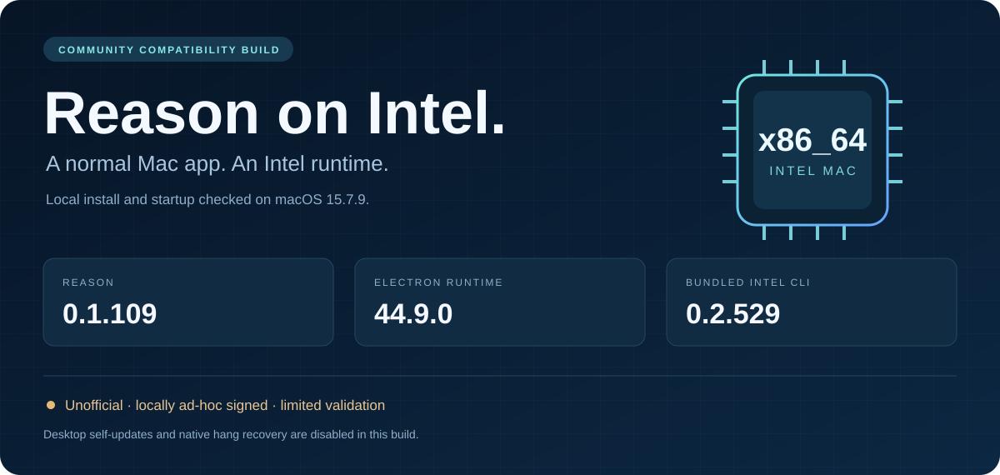
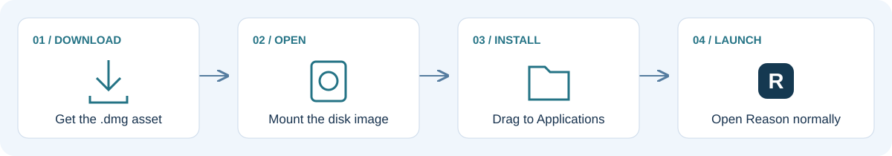
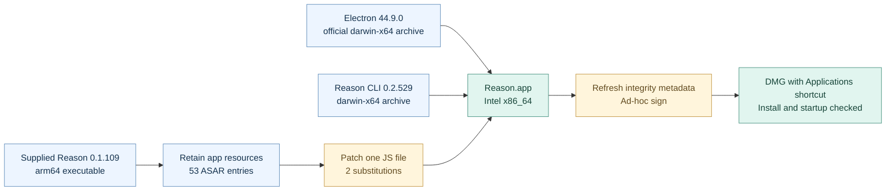

<div align="center">



# Reason · Intel compatibility build

**Reason 0.1.109 packaged with an Intel Electron runtime and Intel CLI.**  
Created after the supplied Apple Silicon app could not run on the test machine's Intel processor.

[**Download Intel DMG ↓**](https://github.com/infinitule/reason-intel-compatibility/releases/download/v0.1.109-intel-local/Reason-0.1.109-Intel.dmg) · [All release files](https://github.com/infinitule/reason-intel-compatibility/releases/tag/v0.1.109-intel-local) · [Verification record](docs/verification.md)

**Intel x86_64** · **186.8 MB download** · **Local startup tested** · **Unofficial**

</div>

> [!IMPORTANT]
> This is a community compatibility rebuild, not a publisher-signed Reason release. The app is **locally ad-hoc signed**. **Desktop self-updates and native hang recovery are disabled.** Validation covers the artifact and local installation/startup; it does not establish complete feature compatibility or security. Read the [limitations](#limitations-and-untested-behavior) before using it.

**On this page:** [Install](#install) · [Compatibility](#compatibility-at-a-glance) · [What changed](#what-changed) · [Verification](#verify-your-download) · [Testing](#what-was-actually-tested) · [Developer handoff](#for-the-reason-developers) · [Sources](#evidence-and-sources)

## Install



1. Download **`Reason-0.1.109-Intel.dmg`** from the [release assets](https://github.com/infinitule/reason-intel-compatibility/releases/tag/v0.1.109-intel-local). The automatically generated source archives are **not** the app installer.
2. Open the DMG. It contains **Reason.app**, an **Applications** shortcut, and **READ-ME.txt**.
3. Drag **Reason.app** onto **Applications**.
4. Open **Reason** from Applications and follow its sign-in flow.

**No separate Electron installation or `path-to-app` command is needed.** The runtime and app resources are already inside the app bundle. Normal launch from Applications was checked on the test Mac. [Evidence](docs/verification.md#local-runtime-observations)

### If macOS shows an unidentified-developer warning

This build does not carry the publisher's Developer ID signature. If you have reviewed the provenance and decide to run it, follow Apple's [instructions for opening an app from an unidentified developer](https://support.apple.com/en-us/102445): after attempting to open it, use **System Settings → Privacy & Security → Open Anyway**, if offered. Do not disable Gatekeeper globally. A malware warning or a checksum mismatch is not something this README instructs you to override.

## Compatibility at a glance

| Item | Verified value | What that establishes |
| :--- | :--- | :--- |
| Test machine architecture | `x86_64` | Local testing occurred on an Intel Mac |
| Tested macOS | `15.7.9` | One observed OS version, not a supported-version range |
| App's declared minimum macOS | `13.0` | An `Info.plist` declaration; macOS 13 was **not** tested |
| Reason app version | `0.1.109` | Preserved from the supplied app |
| Electron framework version | `44.9.0` | Matching version in the original and rebuilt bundles |
| Bundled CLI package | `0.2.529`, `darwin-x64` | Intel CLI archive included in the DMG |
| Desktop native files | 14 Mach-O files, all with `x86_64` | Architecture inspection of the rebuilt app, excluding binaries inside the compressed CLI archive |
| Signing | Ad-hoc | Local signature verification passes; no publisher identity is asserted |

Source: [artifact inspection data](docs/verification.json). **Other Intel Macs, other macOS versions, and Apple Silicon execution have not been validated for this rebuild.**

## Why this rebuild exists

The supplied DMG passed `hdiutil verify`. Its main executable and native hang-recovery helper were both **arm64-only**, while the local machine reported **x86_64**. The original app's minimum macOS declaration was already below the test machine's OS version. These checks identified an architecture mismatch in the supplied app. [Artifact evidence](docs/verification.json)

The approach was to reuse Reason's packaged app resources with the **same Electron version built for Intel**, replace the bundled CLI archive with its Intel counterpart, and make two narrowly scoped JavaScript substitutions. Electron documents this form of [manual packaging with prebuilt binaries and an ASAR archive](https://www.electronjs.org/docs/latest/tutorial/application-distribution).



## What changed

| Component | Supplied package | Intel rebuild |
| :--- | :--- | :--- |
| Main executable and Electron runtime | Apple Silicon package; Electron `44.9.0` | Intel runtime from Electron `44.9.0` |
| CLI release archive | `reason-machines-cli-darwin-arm64-0.2.529.tgz` | `reason-machines-cli-darwin-x64-0.2.529.tgz` |
| Native hang-recovery launcher | Starts the supplied native helper | Returns early on `x64`; no ARM helper is shipped in the rebuilt bundle |
| Desktop updater initialization | `enabled: Ie` | `enabled: !1` — disabled |
| ASAR integrity | Original per-file and header hashes | Recomputed and verified against rebuilt content |
| App signature | Original package signature | Local ad-hoc signature |
| Distribution | Original DMG | New DMG with drag-to-Applications layout |

### How small is the application-code change?

The original and rebuilt ASAR archives contain the **same 53 paths**. Of those entries, **52 are byte-identical**. Only **`dist/main.cjs`** differs, and that difference is exactly the two substitutions below. This statement concerns the app archive; the native runtime outside the archive was replaced. [Machine-readable comparison](docs/verification.json)

<details>
<summary><strong>Inspect the exact two JavaScript substitutions</strong></summary>

In the bundled, minified JavaScript, the recovery function originally starts with:

```js
async function rB(e){
```

The rebuild inserts this Intel-specific early return at the beginning:

```js
async function rB(e){
  if (process.arch === "x64") {
    e.record("desktop.app.hang_recovery_unavailable",
      { reason: "local_intel_build" }, "warn");
    return () => {};
  }
  // Existing function body follows unchanged.
```

The desktop updater's initialization changes from:

```js
Mi = new RL({ enabled: Ie, /* existing options */ });
```

To:

```js
Mi = new RL({ enabled: !1, /* existing options */ });
```

These excerpts are formatted for readability. The byte comparison verifies the actual minified substitutions. No claim is made that these edits restore the disabled functionality.

</details>

The main `Info.plist` retains the bundle identifier **`com.reasonmachines.desktop`**, the app version, and its minimum OS declaration. Its two changed fields are the **ASAR integrity hash** and the added **`ReasonLocalIntelRebuild: true`** marker. Some helper processes retain the stock **Electron Helper** names. [Inspection data](docs/verification.json)

## Verify your download

The release contains these three files:

| Asset | Purpose |
| :--- | :--- |
| [Reason-0.1.109-Intel.dmg](https://github.com/infinitule/reason-intel-compatibility/releases/download/v0.1.109-intel-local/Reason-0.1.109-Intel.dmg) | Installable app package; **186,774,846 bytes** (186.8 MB decimal / 178.1 MiB) |
| [Reason-0.1.109-Intel.sha256](https://github.com/infinitule/reason-intel-compatibility/releases/download/v0.1.109-intel-local/Reason-0.1.109-Intel.sha256) | Checksum file |
| [Reason-Intel-Developer-Notes.txt](https://github.com/infinitule/reason-intel-compatibility/releases/download/v0.1.109-intel-local/Reason-Intel-Developer-Notes.txt) | Initial handoff notes |

**Expected DMG SHA-256**

```text
2833074b90362aac9763442a70fd74a1cee1ee5cd3655122cef61be60e2e4e83
```

Optional Terminal check, from the folder containing both downloaded files:

```sh
shasum -a 256 -c Reason-0.1.109-Intel.sha256
```

The local DMG hash was compared with GitHub's release-asset digest and matched. A matching checksum establishes that the bytes match this recorded artifact; it is **not** a malware scan or proof of publisher endorsement. [Verification record](docs/verification.md#release-asset-integrity)

<details>
<summary><strong>Runtime and CLI input checksums</strong></summary>

**Electron: `electron-v44.9.0-darwin-x64.zip`**

```text
fd9d60a1d6cbe98105c3cdd345f7dcca0961364650e6fbbf49d13e58b0f34786
```

Matched the downloaded archive against Electron's official release checksum file and the GitHub asset digest. [Official release](https://github.com/electron/electron/releases/tag/v44.9.0) · [Checksums](https://github.com/electron/electron/releases/download/v44.9.0/SHASUMS256.txt)

**Reason CLI: `reason-machines-cli-darwin-x64-0.2.529.tgz`**

```text
c1b5347ef92990c511bd4abe75105225bb32b7d319e809f1cf29e398c6341f9b
```

Matched against the `SHA256SUMS` shipped inside the original Reason DMG. Downloaded from the [Reason-hosted CLI release URL](https://reasonmachines.com/cli/releases/download/cli-v0.2.529/reason-machines-cli-darwin-x64-0.2.529.tgz).

</details>

## What was actually tested?

| Check | Result | Scope |
| :--- | :--- | :--- |
| Original and rebuilt DMG checksums | **PASS** | `hdiutil verify` |
| Rebuilt native desktop architectures | **PASS** | 14 inspected Mach-O files contain `x86_64` |
| Local bundle signature | **PASS** | `codesign --verify --deep --strict` |
| ASAR integrity | **PASS** | Per-file hashes, block hashes, and header hash checked |
| Application-code comparison | **PASS** | Exactly two substitutions in one ASAR entry |
| Intel CLI version command | **PASS at initial test** | Returned `0.2.529` |
| Isolated startup | **PASS at initial test** | Remote desktop page loaded and Reason interface rendered |
| Normal installed-app launch | **PASS at initial test** | App in Applications reported `desktop.app.ready` |
| Automatic CLI setup | **OBSERVED** | Installation receipt exists; background process observed during initial install |
| User experience | **USER-REPORTED** | The user confirmed that the installed app works |
| Full feature and agent-workflow suite | **NOT TESTED** | No comprehensive compatibility claim |

The evidence ledger distinguishes artifact checks recorded with a **UTC timestamp** from observations recorded during the initial installation. It does not imply continuing monitoring. [Methods, provenance, and limits](docs/verification.md)

## Limitations and untested behavior

- **Native hang recovery is disabled.** The supplied recovery helper was arm64-only; an Intel replacement is not included.
- **Desktop self-updates are disabled.** This local build has no validated desktop upgrade path. Review later packages manually; this repository makes no claim about future publisher support.
- **CLI update behavior was not modified by these two patches.** Future CLI updates and compatibility were not tested.
- **Signing is local and ad-hoc.** Successful signature verification does not mean Apple or the Reason publisher approved this rebuild. See [Apple's explanation of app trust checks](https://support.apple.com/en-us/102445).
- **One local environment was tested.** Other machines, older macOS releases, the complete permission flow, and full agent workflows remain unverified.
- **The app uses remote Reason services.** A successful local launch is not a guarantee that authentication, account access, or every server-backed feature will work for another user.

## For the Reason developers

This repository is a compatibility handoff: a packaged artifact, precise change notes, and a record of what was checked. It is **not a replacement for your source repository or an official release process**.

Suggested follow-up work, rather than claims about the current package:

- Produce an Intel build of the native recovery helper and validate its behavior.
- Build and test the desktop app and CLI together on the Intel/macOS versions you choose to support.
- Apply your own release signing and notarization process.
- Validate an architecture-aware desktop update route before re-enabling it.
- Exercise sign-in, permissions, agent workflows, failure recovery, and upgrades end to end.

The binary links and checksums above identify the exact local rebuild. The initial [developer notes](https://github.com/infinitule/reason-intel-compatibility/releases/download/v0.1.109-intel-local/Reason-Intel-Developer-Notes.txt) and the [verification ledger](docs/verification.md) provide the handoff detail.

## Evidence and sources

| Reference | Supports |
| :--- | :--- |
| [Artifact inspection JSON](docs/verification.json) | Versions, architectures, archive comparison, signature output, package size and hashes |
| [Verification ledger](docs/verification.md) | Test methods, historical observations, and explicit exclusions |
| [GitHub release metadata](https://api.github.com/repos/infinitule/reason-intel-compatibility/releases/tags/v0.1.109-intel-local) | Published asset names, sizes, hashes, and release status |
| [Electron 44.9.0 release](https://github.com/electron/electron/releases/tag/v44.9.0) | Intel runtime source and its published checksum |
| [Electron packaging documentation](https://www.electronjs.org/docs/latest/tutorial/application-distribution) | Prebuilt-runtime and ASAR packaging mechanics |
| [Apple app-opening guidance](https://support.apple.com/en-us/102445) | macOS trust prompts and per-app opening guidance |

<sub>Prepared by Chandandeep Sharma with Codex assistance. Reason is the application being evaluated; this rebuild is not presented as an official Reason release.</sub>
